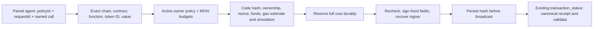

# Monad agent execution

Desktop Agent Access now supports native **MON on Monad mainnet, chain 143**, alongside Ethereum/Sepolia ETH. This extends the existing execution engine, isolated seed-backed accounts, sealed journal, Stop controls and receipt tracking. Monad already exists in the wallet's normal chain registry; no new RPC service, dependency, general signing API or mobile listener is added. Monad mainnet execution is denied in Testnet Mode. No Monad testnet contract deployment is inferred from a mainnet address.

## Native MON

Use existing CLI/MCP commands with `chain: "monad"`:

```json
{ "requestId": "mon-approved-001", "chain": "monad", "recipient": "0xREPLACE_WITH_VALID_ADDRESS", "amount": "0.1" }
```

`wallet_request_transaction` / `request-transaction` enters the existing owner-review inbox. The wallet displays MON, full addresses, maximum fee and maximum total; **Approve and send** signs/submits once. `wallet_send_autonomous` / `send-autonomous` accepts the same fields plus `policyId`, requires a matching **Monad** isolated-account policy, and signs within its limits. `wallet_transaction_status` / `transaction-status` takes `{transactionId}` and verifies the canonical receipt. Explorer links use Monadscan. `submitted`, `confirmed` and `finalized` remain distinct; an uncertain send retains its hash and must never be replaced by a new request ID.

Authorize a policy in **Agent Access → Authorize an autonomous spending account → Spending network → Monad mainnet (MON)**. Set native recipient addresses, per-send total, rolling 24-hour budget, lifetime budget, maximum fee and expiry. Caps are in MON and include value plus maximum fee; ETH policies cannot be reused as MON permission. New policies reserve unused account indexes from 1000, backed by the same seed. They never access/top up from the main account. Fund the displayed address separately with only the intended MON. Immutable terms, pairing expiry, Privacy Mode/lock/account/mode checks, revocation and kill switches apply as before.

**Recover MON** stops the policy, requires the wallet password and a fresh owner-approved native transfer, and works after revocation/restart. It sends MON only. Preserve the displayed derivation path with the offline seed backup. An unresolved send from the same address/chain blocks another send or recovery until reconciliation; preserve the journal/hash instead of resetting it.

## Restricted Emogotchi calls

This is a separate opt-in on a new Monad policy: **Allow Emogotchi care calls**, followed by **1–100 exact token IDs**. Existing ETH/MON policies gain no contract authority automatically. Native recipient addresses may be empty for a contract-only policy. The same policy's per-send/24-hour/lifetime/fee limits cover both MON sends and contract calls; the fixed contract value cap is **1 MON**, excluding separately bounded fees. For example, per-send **1.1 MON**, maximum fee **0.1 MON**, daily **3 MON**, total **5 MON** can cover a paid care call if the actual prepared fee fits. These are example configuration values, not automatic authorization or funding.

| Contract / chain | Function | Arguments | Exact value |
|---|---|---|---|
| `0xC0A0808cbAF507b80df92b22feD8D3810eAB45d5` / 143 | `feed`, `wash`, `play`, `sleep`, `clean` | one allowed `uint256 id` | 1 MON |
| Same | `pet` | allowed `uint256 id`, `uint256 count` from 1–20 | 0 MON, nonpayable |

The agent tool is `wallet_call_autonomous`, CLI `call-autonomous`:

```json
{
  "policyId": "RETURNED_MONAD_POLICY_ID",
  "requestId": "pet-feed-001",
  "chain": "monad",
  "contract": "0xC0A0808cbAF507b80df92b22feD8D3810eAB45d5",
  "function": "feed",
  "args": ["7"],
  "value": "1"
}
```

IDs/counts are canonical positive decimal **strings**, not JS numbers; `value` is the exact decimal MON string `"1"` or `"0"`. For petting use `"function":"pet", "args":["7","2"], "value":"0"`. The wallet builds calldata from its fixed ABI; caller-supplied calldata, ABI, selectors, gas, fallback/receive payments, batches, approvals and NFT transfers are rejected. `revive` (1,000 MON) and `setName` (10 MON) remain blocked. Those high-value actions would require a separately designed and explicitly authorized capability outside this 1-MON policy; there is no hidden agent opt-in or override.

**Ownership and recovery:** the verified contract requires `msg.sender` to own the pet. The isolated spending address must therefore own each permitted NFT, and the wallet checks `ownerOf` before signing. Funding MON does not delegate ownership from the main wallet. Transferring a pet to this address is a separate owner-controlled NFT transfer. **NFT recovery from an isolated account is currently manual**, using a trusted wallet that supports the displayed seed derivation path; **Recover MON does not recover NFTs**. Do not transfer a pet without keeping that path with the seed backup. Other pet contracts need separate explicit contract/function rules; arbitrary calls are never enabled by general Monad support.

## Execution and threat boundaries



- Reviewed Sourcify **exact_match**, non-proxy deployment, verified 2026-09-15, and independently read live chain ID/code on 2026-10-25. Runtime hash pinned to `0x6b1b2801096bd8d3fd5245ecdd050d565d801863c915e12cc4178dc7fca411d1`. Source ABI confirms the five payable care functions, `pet` nonpayable/count≤20, exact prices, and owner checks. Runtime mismatch fails closed.
- Fixed EIP-155 legacy transactions include chain ID 143. Undelegated EOA senders only; ordinary native transfers also require EOA recipients. The contract receive fallback cannot bypass the named-function allowlist. Keys and serialized signed transactions stay inside the desktop main process.
- Monad charges the signed **gas limit**, not only gas used. Contract gas comes from a successful estimate, with a hard 5,000,000-gas ceiling and no fallback inflation on reverts. Maximum fee is `gas limit × gasPrice`; the entire amount plus fee is reserved before signing. A fresh estimate/simulation, code/owner/nonce/fee check runs again before signing; increased gas/price is rejected. Current state can still change before inclusion, so a simulated call can revert and consume gas. Reserved budgets remain conservatively charged for failed/reverted/uncertain sends.
- Same request ID binds account/grant/context/policy/chain/recipient/value/function/arguments/calldata; retries return the same record/hash. Global execution serialization, nonce-slot reconciliation, stale-nonce rejection, immutable policy terms, durable hash-before-broadcast, and Stop during async work are retained.
- Receipt verification checks chain, sender, contract, exact calldata/value/nonce, signed gas limit, fee ceiling and canonical block. A provider claim alone is not settlement proof. No background caretaker, automatic NFT transfer, top-up, gas sponsor, permit or on-chain session key is included. Policies depend on the trusted wallet/OS; a stolen seed is outside their protection.
- Autonomous transport calls require working bounded activity storage before execution. Activity records omit arguments, IDs, calldata, credentials and provider bodies. Sealed journal corruption/write failures deny operations; no automatic reset. Old journal records remain compatible and restart still stops every policy.

## Sources and verification

- [Verified contract/source and ABI](https://sourcify.dev/server/v2/contract/143/0xC0A0808cbAF507b80df92b22feD8D3810eAB45d5?fields=all)
- [Monad network](https://docs.monad.xyz/developer-essentials/network-information), [gas pricing](https://docs.monad.xyz/developer-essentials/gas-pricing), [transaction formats](https://docs.monad.xyz/developer-essentials/transactions), [reserve balance](https://docs.monad.xyz/developer-essentials/reserve-balance)

Public source/read-only code evidence and test logs: `.local-artifacts/agent-monad/`; pinned runtime fixture: `src/main/__fixtures__/emogotchi-runtime.json`. Unit tests and a disposable public-seed Electron journey intercept all EVM RPC submission. The live probe read only chain ID and contract code; it did not access the user's wallet or sign/broadcast.

## Local verification — 2026-10-25

`CI=1 npm run verify:ci` completed with **exit 0**, HEAD `24d088b8f8af2ba583008e1323d2b0a1498ca544` plus the uncommitted shared working tree:

- All five TypeScript targets; **188 unit files / 2,762 tests**. Focused execution/Monad/broker/x402 regression run: **142 tests**. Tests cover fixed calldata and exact values, token-ID/method/contract rejection, code/ownership/gas drift, gas-inclusive shared budgets, native fallback bypass rejection, zero-value RLP signing, request/chain binding, expired/stopped/revoked/locked/mode-changed signing, uncertain-hash retries, native recovery and receipt calldata/gas identity.
- Fresh Electron, extension and injection builds. Full Playwright: **101 passed, 4 flaky passed on retry, 1 existing currency skip** (18.4 minutes). Retry areas were existing Sappy Seals, history repeat visits, downloads and natural-material themes; their assertions were not changed.
- Agent Access, ETH execution, **Monad execution**, and x402 journeys all passed first attempt against the fresh build. Monad covers native approval/receipt, isolated MON sending, feed and nonpayable pet, denied token IDs/revive/raw calldata, duplicate protection, shared daily-budget denial, Stop, revocation and owner MON recovery. Decoded fixture submissions show the intended chain143, sender, call data and values. RPC broadcasts are intercepted; this is **not live settlement**. On a host without OS secure storage, the test explicitly verifies denial instead of claiming positive signing coverage.
- Policy screenshots reviewed at **400/768/1200** widths, with no horizontal overflow. **203 generated assets** (202 tracked PNGs and app-hub source) hash-verified against pre-run contents; **9 generated PNG replacements** archived and originals restored. `git diff --check` passed.
- Production audit passed the critical threshold: **0 critical, 5 high, 4 moderate**. No dependencies were added or upgraded; manifests/lockfile unchanged. Existing advisories need separate dependency review.

Evidence: `.local-artifacts/agent-monad/{verify-ci.log,verify-ci.exitcode,focused.log,e2e-monad.log,generated-restoration.json}` and policy screenshots. Earlier failed focus probes are diagnostic: an accessible select name was made explicit, and decoded zero-value signing was fixed with a regression test before the final full gate.

**GitHub CI is pending for these uncommitted/unpushed changes.** No commit, push, release, deployment, live signing/broadcast/funding, NFT transfer/recovery or native-device validation was performed. Live MON/contract operation remains pending in `docs/RELEASE-QA.md`. NFT recovery remains manual via the displayed seed path; no external security audit is claimed.

Implementation map: `src/main/agent-emogotchi.ts` (closed ABI/code pin); `agent-execution-{core,desktop}.ts` (shared policies, signing, receipts); `agent-access{,-core}.ts` and `resources/agent-access.mjs` (native authorization and CLI/MCP); `src/shared/agent-execution.ts` (wire/network contracts); `AgentExecutionPanel.tsx` / `X402Controls.tsx` (network-specific controls and recovery wording). Tests are in `agent-monad.test.ts`, execution signer/broker tests and `e2e/agent-monad{.spec.ts,-wrapper.cjs}`.
